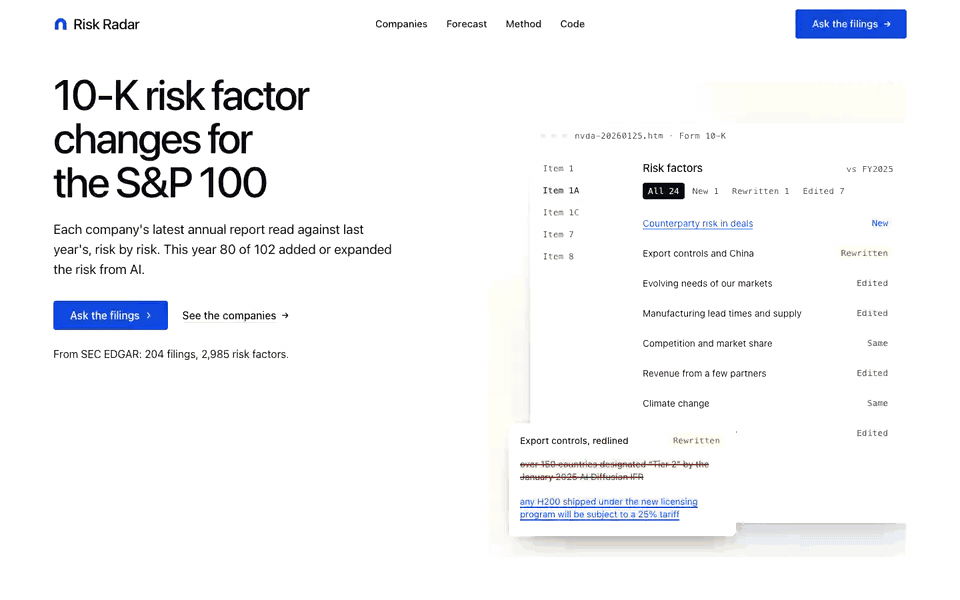

# Risk Radar

An AI analyst for S&P 100 risk filings: it measures how often it is right,
and it made public predictions it will be graded on.

Live: https://risk-radar-ten.vercel.app

## In 60 seconds

Every S&P 100 annual report (10-K, Item 1A risk factors) compared with last
year's, risk by risk; an agent that answers questions about them and cites
the exact sentence behind every claim; and forecasts of what each company will
add to its next 10-K, committed before the filings exist. Each version
answered one question and has one number that says whether it worked:

| Version | Question | Headline number |
|---|---|---|
| v1, the radar | What did each company change in its risk factors this year? | 80 of 102 added or expanded AI risk |
| v2, Ask the filings | Can anyone ask the filings and trust the answer? | 83% of answers correct (72% to 93%) |
| v3, the forecast | What will each company add next, in a way that can be checked? | Backtest Brier 0.166 vs 0.182 for the base rate |
| v4, in public | Does it hold up in use? | Counting questions right: 16 of 30 before a fix, 28 of 30 after |

Every version, with what it shipped and its limits: `docs/VERSIONS.md`.

## Results

Ask the filings, on Claude Haiku 5.5 (low effort), over 63 test questions
(54 answerable, 9 deliberately unanswerable). 95% bootstrap intervals.

| Measure | Result |
|---|---|
| Answers correct, graded against the reference answer | 83% (72% to 93%) |
| Correct or partly correct | 94% (87% to 100%) |
| Claims fully backed by the sentence they cite | 80% (74% to 87%), 122 of 152 |
| Unanswerable questions declined | 9 of 9 |
| Answers citing text the search never returned | 0 |
| Cost per answer | $0.0006 |
| Typical / slowest-5% answer time | 2.3 s / 3.3 s |

Claude Sonnet 5.5 on the same questions: 93% correct, 89% of claims backed,
$0.0102 an answer. Paired against Haiku it answers 9 more in 100 correctly,
95% interval -2 to 20, at 18 times the cost, so Haiku stays. A stricter
grounding prompt on Haiku dropped correct answers to 72% and was reverted.

Search numbers are from Linux x64, the platform the live function runs on,
and CI fails if they stop reproducing. On a Mac the same code scores 87% on
the last row: ONNX arithmetic differs slightly across CPUs and flips a few
close rankings. The answer runs above were made on a Mac.

| Search method | Right risk factor in top 5 | MRR |
|---|---|---|
| Keywords only (BM25) | 46% (33% to 59%) | 0.33 |
| Meaning only (bge-small embeddings) | 57% (44% to 70%) | 0.45 |
| Both, fused (RRF) | 59% (46% to 72%) | 0.50 |
| Both, limited to the company named | 83% (72% to 93%) | 0.73 |

The test questions and reference answers were written by Claude (Opus 5.5)
from risk factors sampled one per company, and answers were graded by Claude
Sonnet 5.5. On 30 answers drawn at random and graded by hand (by me, the
author), the model grader gave the same verdict 26 times; where they differed
it was stricter 3 times and more lenient once, so the 83% is if anything low. Every question and every
graded answer is in `data/golden/` and `results/`. Full write-up with each
failure quoted: https://risk-radar-ten.vercel.app/#eval

## How it works

1. `tools/fetch_filings.py` pulls the two latest 10-Ks per company from EDGAR;
   `tools/build_radar.py` splits Item 1A into risk factors, matches them
   year over year (bge-small, one-to-one, cosine >= 0.80), detects splits and
   merges, and labels each edit (new exposure, escalated, softened,
   boilerplate) with an LLM classifier.
2. `tools/build_ask_index.py` turns this year's risk factors into sentences
   with stable ids and ~1,000-character passages; `api/_tools/embed.mjs`
   embeds them offline with the same quantized model the server loads.
3. `api/ask.js` is the only server code: a Vercel function running a small
   tool-using agent (`search_filings`, `get_company`, `compare_years`,
   `theme_trend`). Every sentence a tool returns gets a per-request number;
   the answer must cite those numbers, and any citation the tools did not
   return blocks the answer.

## What the live Ask costs

Budget: at most $2 a month. One answer costs about $0.0006 to $0.001.

- The three example questions on the Ask page are answered once, offline
  (`api/_tools/examples.mjs` -> `site/data/examples.json`), and served from
  that file: clicking one never calls the model.
- 5 questions per visitor a day and 60 a day per server (`IP_DAILY`,
  `DAILY_CAP`); 60 x $0.001 = $0.06 a day, under $2 even if every day hits it.
- At most 4 model turns and 800 output tokens a turn (`LIMITS` in
  `api/_lib/agent.js`). Repeated questions are served from memory.
  Rerun at these limits on the same 63 questions
  (`results/answers-claude-haiku-5-5-low-cap800.jsonl`): 83% correct
  (72% to 93%), the same as the published run.
- The hard stop is a $2 monthly spend limit on the Anthropic workspace that
  holds the key. The two caps above live in server memory and reset on a new
  instance; the workspace limit cannot be bypassed.
- Optional, not built: a durable monthly counter (Upstash Redis through the
  Vercel Marketplace, free tier) refusing above `MONTHLY_CAP` = 1,500 answers.
- `GET /api/health` lists the models on the key, which spends no tokens;
  `.github/workflows/uptime.yml` calls it and loads every page every six
  hours, and a failed run emails the repo owner.
4. `api/_tools/eval.mjs` runs the golden set through the same search and agent
   code that ships.

## Counting questions (v4)

The golden set asks about one company at a time, so it missed a failure found
in use: asked which companies stopped mentioning ESG, Ask said none had, while
the board shows 26 of 53. The counting tool covered six themes, and the data
on terms companies dropped (ESG, COVID-19) was never connected to it.
`api/_tools/eval_counts.mjs` asks the ten counts the board prints and passes an
answer only if it states the board's number and cites a sentence. Three runs
each, before and after connecting the data (`reports/counts_eval.json`):

| Counting questions | Before | After |
|---|---|---|
| All ten, three runs | 16 of 30 | 28 of 30 |
| ESG and COVID-19 (three questions, three runs) | 0 of 9 | 9 of 9 |

The two misses after the fix gave the right number without citing it. The
63-question golden set, rerun after the fix
(`results/answers-claude-haiku-5-5-low-v4.jsonl`): 78% correct (67% to 89%),
9 of 9 unanswerable declined; paired against the published run, -6 points
(-17 to +6). None of the nine answers whose verdict moved called the changed
tool, so this is run-to-run variation at low effort, not the fix. The
published 83% stays the headline because the hand-grading check was done on it.

Page views are counted with Vercel Web Analytics: no cookies, nothing stored
on the visitor's device.

## Forecast (v3, in progress)

For each company and theme, the chance that its next 10-K adds or escalates
risk language on that theme: the six themes above plus interest rates and
credit, and government shutdown and spending. The forecasts are committed
before the filings exist and scored when they land; a forecast committed after
a company's filing is refused by the scorer. A forecast of what companies will
write, not of what will happen to them.

    SEC_USER_AGENT="name email" python3 tools/fetch_10q.py   # 10-Qs, 8-K items, one older 10-K
    PYTHONPATH=src:tools python3 tools/extract_10q.py         # 10-Q Item 1A: updated / no_change / reference_only
    PYTHONPATH=src:tools python3 tools/forecast_features.py   # signals per company and theme
    PYTHONPATH=src:tools python3 tools/forecast.py            # backtest vs baselines, draft forecast
    PYTHONPATH=src:tools python3 tools/forecast.py --freeze   # done: frozen 2026-11-17, commit 950eaa9
    PYTHONPATH=src:tools python3 tools/score_forecast.py      # once 10-Ks land (data/outcomes.json)

Baselines: B0, each theme's share of companies that added it last year; B1,
that share split by whether the company's own mentions rose. Scored by Brier
score and log loss, out of sample (10 folds by company), with intervals from
resampling companies.

| Backtest (808 forecasts, 101 companies, last year's 10-Ks) | Brier | Log loss |
|---|---|---|
| B0, each theme's share | 0.182 (0.170 to 0.196) | 0.547 |
| B1, plus the company's own trend | 0.178 (0.165 to 0.193) | 0.536 |
| Logistic model | 0.166 (0.151 to 0.181) | 0.502 |

Model minus B0: -0.017 (-0.028 to -0.005). The strongest signal is how much
the last 10-K already says about a theme, then new 10-Q risk text on it.
30 of 102 companies wrote new risk text in a 10-Q since their latest 10-K;
the rest said there were no material changes or pointed back to the 10-K
(12, mostly banks and drug makers, have no 10-Q risk section at all), and 8
have filed no 10-Q yet. Disney's next 10-K was out before the forecast, so it
is not forecast.
The base rates assume next year's filings add each theme about as often as
this year's did; a year with far less AI or tariff news would break that.

API spend on v3 so far: $0.13 (the Haiku rerun at the new caps with its Sonnet
grading, $0.13, and the stored example answers, under $0.01).

## Reproduce

    make test                                  # Python tests, no install
    node api/_tools/eval.mjs retrieval         # search ladder, no API key
    node api/_tools/eval.mjs answers claude-haiku-5-5 low   # needs ANTHROPIC_API_KEY
    node api/_tools/eval.mjs report            # writes site/data/eval.json
    node api/_tools/dev.mjs                    # local site on :8787

Decisions and their reasons: `DECISIONS.md`. Every version, what it answered
and what it measured: `docs/VERSIONS.md`.
